<a href="https://keelinfra.io">
  <picture>
    <source media="(prefers-color-scheme: dark)" srcset="https://raw.githubusercontent.com/keelinfra/.github/main/assets/readme/profile-hero-dark.svg">
    
  </picture>
</a>

  <a href="https://keelinfra.io"><b>keelinfra.io</b></a> &nbsp;·&nbsp;
  <a href="https://keelinfra.io/evidence/"><b>Evidence</b></a> &nbsp;·&nbsp;
  <a href="https://keelinfra.io/blog/"><b>Blog</b></a> &nbsp;·&nbsp;
  <a href="https://keelinfra.io/#get-involved"><b>Get involved</b></a>

 

  <a href="https://github.com/keelinfra/jenkins-extended-security"><picture><source media="(prefers-color-scheme: dark)" srcset="https://raw.githubusercontent.com/keelinfra/.github/main/assets/readme/card-jenkins-extended-security-dark.svg"></picture></a>
  <a href="https://github.com/keelinfra/agent8"><picture><source media="(prefers-color-scheme: dark)" srcset="https://raw.githubusercontent.com/keelinfra/.github/main/assets/readme/card-agent8-dark.svg"></picture></a>

  <a href="https://keelinfra.io/jenkins/upgrade-matrix/"><picture><source media="(prefers-color-scheme: dark)" srcset="https://raw.githubusercontent.com/keelinfra/.github/main/assets/readme/card-jenkins-upgrade-check-dark.svg"></picture></a>
  <a href="https://github.com/keelinfra/aix-runner"><picture><source media="(prefers-color-scheme: dark)" srcset="https://raw.githubusercontent.com/keelinfra/.github/main/assets/readme/card-aix-runner-dark.svg"></picture></a>

 

### How every keelinfra project works

| **01 · Open source first** | **02 · Tested in public** | **03 · Built with its users** |
| :-- | :-- | :-- |
| The code, install scripts and tests are public. You can run everything without talking to us. | Linux, the upgrade rehearsals and the security backports are tested in public CI. AIX, Solaris and HP-UX are tested by hand, not in CI, and each README says so. [The evidence ledger →](https://keelinfra.io/evidence/) | Bugs, questions and fixes go to each project's issues and pull requests, where the answer helps the next person too. A test report from a platform we can't reach is the most useful thing you can send. |

 

Everything here is free and open source: Agent8 under MIT (its jars include LGPL-2.1 classes from JvmDowngrader), jenkins-extended-security under MIT (its patches keep the Jenkins, Remoting and Stapler licenses), jenkins-upgrade-check under Apache-2.0, aix-runner under MIT (based on GitLab software; not affiliated with GitLab Inc.). Not affiliated with the Jenkins project. The earlier Keycloak distribution was [discontinued](https://keelinfra.io/keycloak/) on 24 October 2026.
